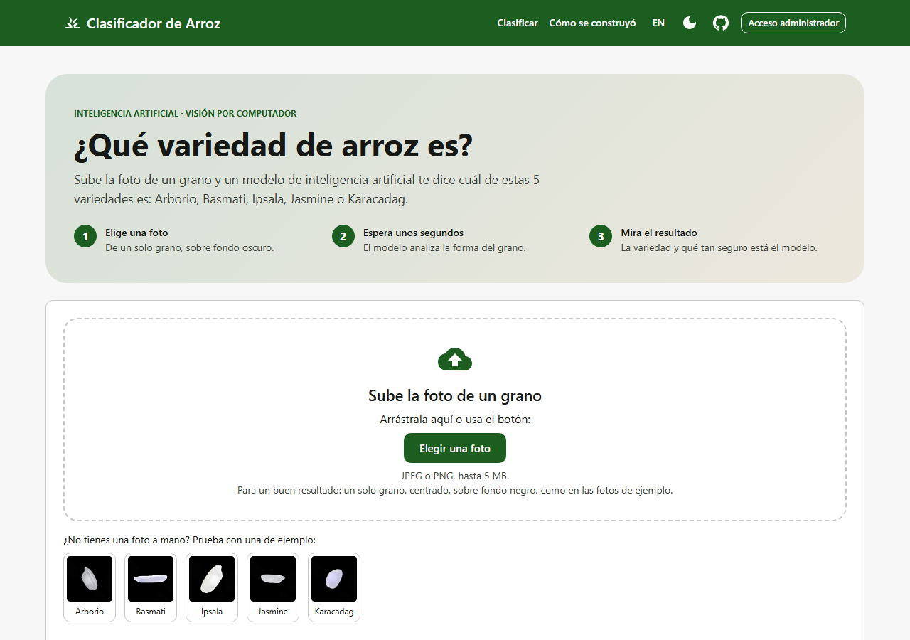

<!--
Nombre: README.md
Descripción: Qué hace el proyecto, qué hay en cada notebook, resultados, arquitectura,
             tecnologías y cómo ejecutarlo.
Fecha de creación: 2026-10-18
Última actualización: 2026-11-26
Autores: Julian Delgado (@JulianDM22), Cesar Camilo Hoyos Diaz (@Camilo1408)
Versión: 2.0.0
-->

# Clasificador de variedades de arroz

Proyecto de **Inteligencia Artificial**: modelos de visión por computador que reconocen 5 variedades
de arroz (Arborio, Basmati, Ipsala, Jasmine, Karacadag) a partir de la foto de un grano, entrenados
con el [Rice Image Dataset](https://www.muratkoklu.com/datasets/) (75.000 fotos).

**Aplicación:** https://arroz-frontend.onrender.com. Plan gratuito: la primera visita puede tardar
cerca de un minuto mientras el servidor despierta.



## Notebooks (Kaggle, Keras)

| Notebook | Tema | Qué hace |
|---|---|---|
| `01_preparacion_datos` | 1 | Quita 297 duplicados, partición estratificada 70/15/15 sin fuga, CSV reproducibles, generador por lotes |
| `02_hyperband` | 2 | Busca modelo, tasa de aprendizaje, lote, dropout y épocas con Hyperband |
| `03_validacion_cruzada` | 3 | K-fold estratificado con los 5 modelos; compara k-fold, hold-out y Monte Carlo |
| `04_entrenamiento_final` | 4 y 6 | Entrena los 5 modelos con todos los datos, evalúa en test y mide 1 frente a 2 GPU |
| `05_ensambles` | 5 | Ensambles homogéneo, heterogéneo e híbrido, con prueba de McNemar |
| `06_gan` | 1 | GAN condicional que genera granos por variedad y prueba si sirven para aumentar datos |
| `07_federado` | 6 | FedAvg con 5 clientes, casos IID y no IID |
| `08_exportar_modelos` | — | Exporta los 5 modelos a TensorFlow Lite y los verifica contra el original |

Las salidas de cada notebook están en su versión guardada en Kaggle; los archivos de este
repositorio no las incluyen.

## Resultados en test (11.206 fotos que los modelos no vieron)

| Modelo | Tipo | Test | Validación cruzada (k = 5) |
|---|---|---|---|
| **ResNet50V2** (por defecto en la app) | CNN | **99,91 %** | 99,78 % ± 0,22 |
| EfficientNetB0 | CNN | 99,87 % | 90,83 % ± 10,79 |
| ViT-B/16 | Transformer | 99,80 % | 99,56 % ± 0,49 |
| DeiT-S | Transformer | 99,56 % | 98,53 % ± 0,72 |
| CNN propia | CNN | 99,08 % | 91,21 % ± 8,97 |

El mejor ensamble (heterogéneo) llega a 99,93 %, pero según McNemar la mejora no es significativa
(p = 0,5). Las cifras son altas porque el dataset es de laboratorio: un grano centrado sobre fondo
negro uniforme. Con fotos tomadas con celular se espera menos exactitud.

## Arquitectura

```
Navegador ── React (frontend/) ──► API Spring Boot (backend/) ──► PostgreSQL
                                          │                         (usuarios y registro de clasificaciones)
                                          │ foto + clave X-API-Key
                                          ▼
                              FastAPI + 5 modelos TensorFlow Lite (inferencia/)
```

- **Página pública:** clasificar una foto, comparar los 5 modelos y ver cómo se construyó el proyecto.
- **Panel del administrador:** clasificaciones por día, por variedad y por modelo.

## Tecnologías y por qué

| Parte | Tecnología | Por qué |
|---|---|---|
| Entrenamiento | Kaggle Notebooks (2 GPU T4) | El dataset ya está en Kaggle y las 2 GPU permiten el tema 6 |
| Modelos | Keras 3 / TensorFlow, KerasTuner, keras-hub | Una sola librería para los 6 temas y los 5 modelos preentrenados |
| Servir modelos | TensorFlow Lite (LiteRT) + FastAPI | Liviano: los 5 modelos caben en 512 MB (283 MB en uso) |
| API | Spring Boot + PostgreSQL | Registro de clasificaciones, acceso del administrador y límite de 20 fotos por minuto por IP |
| Interfaz | React + Material UI | Español e inglés, tema claro y oscuro, accesible y adaptable a celular |
| Calidad y despliegue | Docker, GitHub Actions, Render | Cada cambio se prueba y, si todo pasa, se publica solo |

## Ejecutar en local

```bash
docker compose up -d --build --wait
```

Abrir http://localhost:8081. Usuario administrador de desarrollo: `admin` / `Admin123*` (en
producción la contraseña es otra). Fotos de prueba: `inferencia/tests/muestras/`.

## Dataset

Koklu, M., Cinar, I., & Taspinar, Y. S. (2021). Classification of rice varieties with deep learning
methods. *Computers and Electronics in Agriculture, 187*, 106285.
https://doi.org/10.1016/j.compag.2021.106285. Las imágenes no se incluyen en este repositorio.

## Equipo

Julian Delgado ([@JulianDM22](https://github.com/JulianDM22)) y Cesar Camilo Hoyos Diaz
([@Camilo1408](https://github.com/Camilo1408)).
