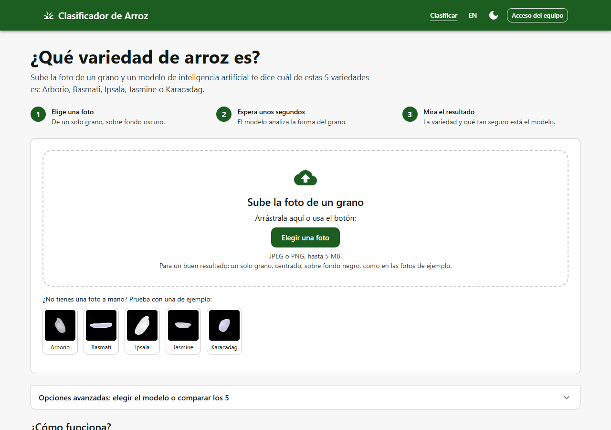
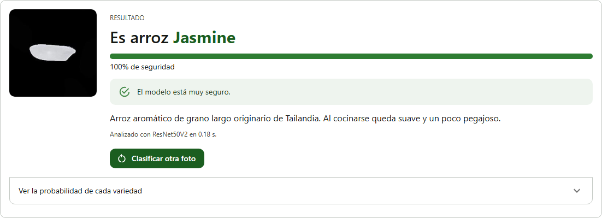
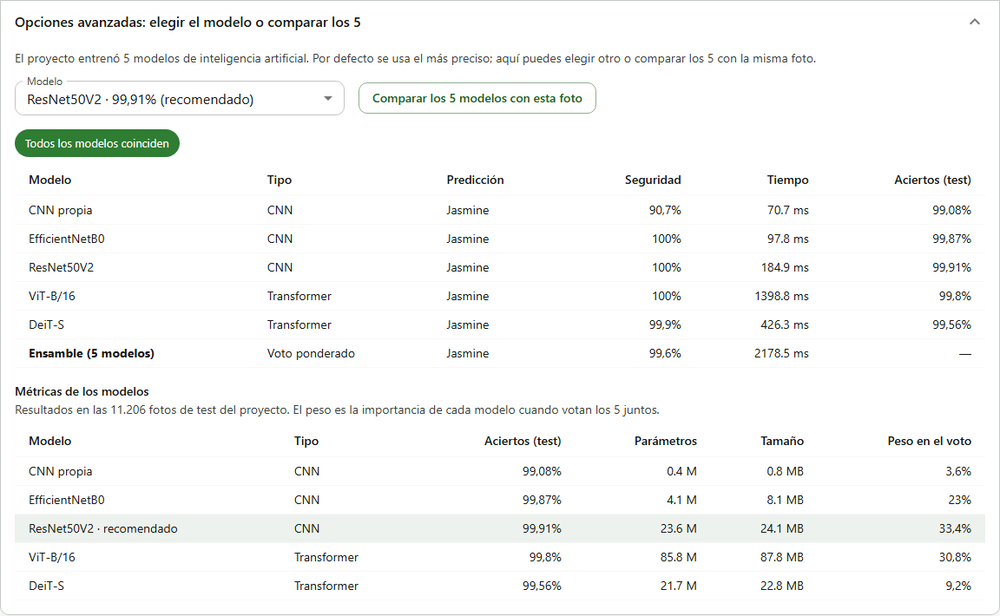

<!--
Nombre: README.md
Descripción: Presentación del proyecto, arquitectura y cómo ejecutar, probar y desplegar.
Fecha de creación: 2026-10-18
Última actualización: 2026-10-21
Autores: Julian Delgado (@JulianDM22), Cesar Camilo Hoyos Diaz (@Camilo1408)
Versión: 1.2.0
-->

# Clasificador de variedades de arroz

**Aplicación en línea:** https://arroz-frontend.onrender.com (plan gratuito: la primera visita
puede tardar cerca de un minuto mientras los servicios despiertan).

Proyecto de la materia **Inteligencia Artificial**. Clasifica fotos de granos en 5 variedades
(Arborio, Basmati, Ipsala, Jasmine, Karacadag) con modelos entrenados sobre el
[Rice Image Dataset](https://www.muratkoklu.com/datasets/) (75.000 imágenes).

**Cómo se usa la página:**
- **Cualquier persona**, sin cuenta, entra, sube la foto de un grano (o prueba con una de las
  fotos de ejemplo) y ve la variedad, qué tan seguro está el modelo y una descripción de la
  variedad. En las opciones avanzadas puede elegir el modelo o comparar los 5.
- **El equipo** entra por "Acceso del equipo" al inventario de lotes de arroz:
  - el **operario** registra y edita lotes, y puede guardar como lote lo que acaba de clasificar;
  - el **administrador** además activa o desactiva lotes, los elimina y tiene un **panel** con
    las estadísticas del inventario y del uso del clasificador.





## Arquitectura

```
React + Material UI ──JSON──► Spring Boot (API REST, JWT) ──► PostgreSQL
    (frontend/)                    (backend/)          (lotes, usuarios y registro de clasificaciones)
                                       │ foto (multipart, clave X-API-Key)
                                       ▼
                     FastAPI + los 5 modelos en TensorFlow Lite
                                  (inferencia/)
```

| Carpeta | Contenido |
|---|---|
| `notebooks/` | Temas 1 a 6 de IA (Kaggle): preparación de datos, Hyperband, validación cruzada, 5 modelos (3 CNN y 2 transformers), ensambles, GAN, aprendizaje federado y distribuido, exportación del modelo |
| `backend/` | API REST: clasificación pública con límite por IP, CRUD de lotes, roles, estadísticas, autenticación JWT, i18n, OpenAPI, Flyway |
| `inferencia/` | Servicio que clasifica la foto con los 5 modelos y el ensamble |
| `frontend/` | Interfaz web: página pública de clasificación, inventario de lotes, panel del administrador, temas, i18n, accesibilidad |
| `pruebas/carga/` | Pruebas de carga, estrés y pico con k6 |
| `db/` | Scripts de creación e inicialización de la base de datos |
| `monitoreo/` | Prometheus, alertas y tablero de Grafana |
| `scripts/` | Gestión del repositorio, compilación y pruebas, listado de casos de prueba |
| `docs/` | Criterios de aceptación, casos de prueba, métricas y despliegue |

## Resultados del modelo

| Modelo | Validación cruzada (k = 5) | Test |
|---|---|---|
| **ResNet50V2** (el de la web) | **99,78 % ± 0,22** | **99,91 %** |
| ViT-B/16 | 99,56 % ± 0,49 | 99,80 % |
| EfficientNetB0 | 90,83 % ± 10,79 | 99,87 % |
| DeiT-S | 98,53 % ± 0,72 | 99,56 % |
| CNN propia | 91,21 % ± 8,97 | 99,08 % |

Los ensambles (homogéneo, heterogéneo e híbrido) llegan a 99,93 %, pero la mejora frente a
ResNet50V2 solo no es significativa (prueba de McNemar).

En la aplicación están los **5 modelos**: por defecto se usa ResNet50V2, el más preciso, y en las
opciones avanzadas se puede elegir otro, usar los 5 juntos (ensamble) o **comparar los 5** con la
misma foto para ver la predicción, la confianza y el tiempo de cada uno, junto con sus métricas
de test.



Los modelos van en TensorFlow Lite (notebook 08). Cada uno se verificó contra su original en
500 fotos de test: coinciden en el 100 % de las predicciones.

| Modelo | Formato | Tamaño | Tiempo por foto (CPU, contenedor) |
|---|---|---|---|
| CNN propia | float16 | 0,8 MB | ~28 ms |
| EfficientNetB0 | float16 | 8,1 MB | ~26 ms |
| ResNet50V2 | int8 | 24,1 MB | ~145 ms |
| ViT-B/16 | int8 | 87,8 MB | ~670–740 ms |
| DeiT-S | int8 | 22,8 MB | ~190–280 ms |

Los 3 modelos grandes van en int8 para que el servicio quepa en los 512 MB del plan gratuito:
con los 5 cargados usa ~283 MB (con float16 llegaba a ~500 MB).

## Ejecutar

```bash
docker compose up -d --build --wait
```

Abrir http://localhost:8081. Para el área del equipo ("Acceso del equipo"), los usuarios de
desarrollo son `admin` / `Admin123*` y `operario` / `Operario123*` (en producción se usan otras
contraseñas, definidas en Render).
Documentación de la API: http://localhost:8080/swagger-ui.html.

## Probar

```powershell
.\scripts\compilar_y_probar.ps1            # back-end, mutación, inferencia y front-end
.\scripts\compilar_y_probar.ps1 -Sistema   # además Playwright, Selenium y k6 sobre docker compose
```

La lista completa de casos de prueba y su relación con los criterios de aceptación está en
[`docs/casos_de_prueba.md`](docs/casos_de_prueba.md); se regenera con
`python scripts/listar_casos_prueba.py`.

## Documentación

- [Criterios de aceptación](docs/criterios_aceptacion.md)
- [Casos de prueba y trazabilidad](docs/casos_de_prueba.md)
- [Métricas, desempeño del equipo y monitoreo](docs/metricas.md)
- [Despliegue](docs/despliegue.md)
- JavaDoc: `cd backend && mvn javadoc:javadoc` → `backend/target/reports/apidocs`
- JSDoc: `cd frontend && npm run docs` → `frontend/docs-js`

## Dataset y cita

Se usa el **Rice Image Dataset** de Murat Koklu (https://www.muratkoklu.com/datasets/), publicado
también en Kaggle. Las imágenes no se incluyen en este repositorio. Los autores piden citar:

- Koklu, M., Cinar, I., & Taspinar, Y. S. (2021). Classification of rice varieties with deep
  learning methods. *Computers and Electronics in Agriculture, 187*, 106285.
  https://doi.org/10.1016/j.compag.2021.106285
- Cinar, I., & Koklu, M. (2021). Determination of Effective and Specific Physical Features of Rice
  Varieties by Computer Vision In Exterior Quality Inspection. *Selcuk Journal of Agriculture and
  Food Sciences, 35*(3), 229–243. https://doi.org/10.15316/SJAFS.2021.252
- Cinar, I., & Koklu, M. (2022). Identification of Rice Varieties Using Machine Learning
  Algorithms. *Journal of Agricultural Sciences*. https://doi.org/10.15832/ankutbd.862482
- Cinar, I., & Koklu, M. (2019). Classification of Rice Varieties Using Artificial Intelligence
  Methods. *International Journal of Intelligent Systems and Applications in Engineering, 7*(3),
  188–194. https://doi.org/10.18201/ijisae.2019355381

## Equipo

- Julian Delgado ([@JulianDM22](https://github.com/JulianDM22))
- Camilo ([@Camilo1408](https://github.com/Camilo1408))
